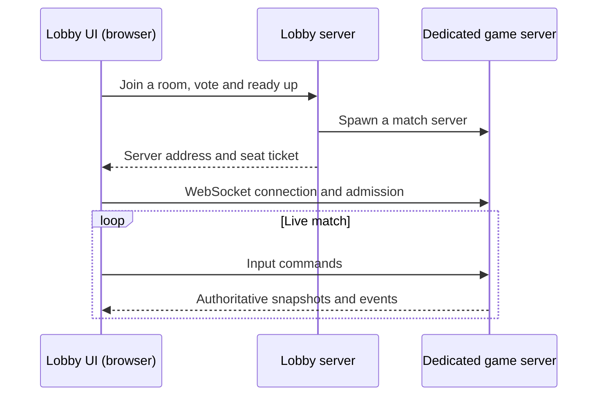

# Multiplayer

How matches happen.

| Page | Covers |
|------|--------|
| [Lobby, Rooms and Accounts](./lobby.md) | The lobby screen, accounts and keys, rooms, ranked matches, leaderboard, profile |
| [Connecting](./connecting.md) | `connect` / `disconnect` console, lobby UI flow, joining a match under way, reconnecting, NetGraph |
| [In-Game Chat](./chat.md) | **T** to talk, history dialog, chat in demos |
| [Demos](./demos.md) | Server-side recording, demo list, playback (normal + cinematic) |

## High-Level Flow

The lobby orchestrates matchmaking and spawns dedicated game servers via `GameServerSpawner`. Players never connect directly to the lobby for gameplay — they connect to the game server the lobby tells them about.

For developer flows, the engine's `map <name> [gametype]` command bypasses the matchmaker and asks the lobby for a one-off dev-spawn. See the engine's Map Launching Guide (`docs/manual/guides/map-launching.md` in the engine repo).
