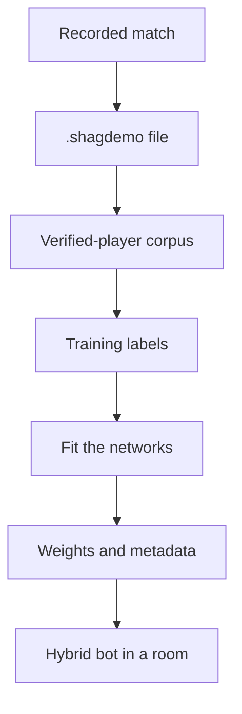

# Training Bots From Demos

The point of this pipeline is bots that move like people. A recorded match is a
record of what a person did; training reads those recordings and fits networks
that the [bot server](./bot-server.md) then hands to its bots, where they sit on
top of the rule-based brain rather than replacing it.

The chain, end to end:



Nothing in it is automatic. A match records itself, but building a corpus and
training from it are commands you run.

## What a recording holds

A game server starts recording when the match phase goes Active and stops at
post-game — no flag, no console command. Files land in `public/data/demos/`
relative to the server's working directory, named
`map_gametype_YYYYMMDD_HHmmss.shagdemo`, and a match shorter than ten seconds is
discarded rather than saved.

Format version 3 records two things per frame: the snapshot, and **the commands
the server applied**. The commands are what make a demo trainable. Without them,
training has to work out which buttons produced the motion it can see, and that
guess is wrong exactly where this game is most itself: in an air-strafe the wish
direction and the velocity point different ways on purpose. Commands arrive at
tick rate while frames are written at snapshot rate, so several fold into one
record — buttons are OR-ed together, so a press between two snapshots is not
lost, and the analogue fields keep the value they ended on.

A frame with no command is not a gap in the data. It means the player sent
nothing over that interval, which is to say they pressed nothing.

## Who counts as a person

A roster entry carries an `accountId` only when that seat was taken with a
verified lobby ticket. Bots have none. Training keeps the verified players and
drops everything else, because a network trained on bot play learns the state
machine it exists to grow beyond.

Pass `--include-bots` to train on every player in the recording. That is for
self-play datasets, where the bot's own behaviour is the point.

## Building a corpus

Point `--demo` at a file or at a directory. A directory is read as one corpus:

```bash
npx vite-node src/cli/bot-train.ts -- --demo public/data/demos --epochs 50
```

- Matches already counted are skipped by match id, so re-running over a growing
  folder does not train twice on the same match.
- A recording that cannot be read, or that holds no verified player, is skipped
  with a reason. One bad file does not cost you the other forty-nine.
- **Whole matches are held back for validation, never single frames.** Frames
  seconds apart in one match are nearly the same frame, so a frame-level split
  reports a score measured on play the network has effectively already seen. With
  a single match there is nothing to hold back, and the run says so: the loss
  then tells you the frames were memorised, not that anything was learned.

Scale, so you know what you are looking at: a three-minute duel yields roughly
ten thousand frames per player. Behaviour cloning wants on the order of a hundred
thousand. One match is a smoke test; a folder of fifty is a training set.

## What the network is asked

The labels are what the person did — not how well the frame went. Reward is the
right signal for sharpening a bot against itself later; it is not an answer to
"what would a person do here", and using it as one meant that on a neutral
frame, which is most frames, every target said 0.5 whatever the player had done.

Every output exists because a demo can answer it:

| Head | Output | Kind | Comes from |
|------|--------|------|-----------|
| Tactical | sprint, slide, jump | yes/no | the buttons held |
| Tactical | switch | yes/no | whether the slot changed since the previous frame |
| Tactical | slot | yes/no, as a share of nine | the commanded slot |
| Combat | fire, alt-fire | yes/no | the buttons held |
| Combat | aim yaw, aim pitch | turn | **the turn made between two frames** |
| Combat | dodge left, dodge right | yes/no | the wish direction given, not the velocity |

A yes/no output is a logit, trained with binary cross-entropy. A turn is a signed
number in tenths of a radian, trained with Huber loss so one flick cannot outweigh
a thousand frames of steady tracking.

Aim is the part worth having: view angles are recorded state, so the turn a
person made is the one label here that was never a guess.

Because aim and weapon labels are *differences*, they are only built inside a
**run** — one player, one match, in order. Two runs are never adjacent, and two
frames within a run must also be close in time: a player who is dead or absent
is skipped, so the array can jump from a death to a respawn hundreds of ticks
later. A turn measured across that jump is a flick made while staring at a
respawn screen. Frames further apart than a dozen ticks are treated as having no
predecessor, which costs one label and invents none.

Frames whose features are the wrong width, or hold a value that is not a number,
are dropped and counted in the run's output. A single NaN in a training tensor
turns the loss to NaN and takes the weights with it.

## What the network sees

Not one frame but the last three, oldest first. A single frame is a still:
whether a player is starting a strafe-jump or finishing one, closing on an item
or leaving it, is invisible in one vector and plain in three. The same gap rule
applies — a stack never reaches back across a death — and until three frames
exist, the oldest one there stands in for the rest, which reads as "nothing was
changing" rather than as the dead, unarmed, motionless player that zeros would
describe.

Every vector is built by one piece of code, used by the demo extractor, by the
self-play recorder and by the bot in a match. That is the promise a trained model
depends on: the vector it is fed in a match was built exactly the way the
vectors it learned from were. Training therefore reads each demo **with its
map** — the same line of sight and item distances a bot on that map would have —
and gives every player their own view of it, as each bot has. A map that will
not load is reported, and its matches are read blind, the way a bot with no map
would play them.

Stacks are one snapshot apart on both sides, because a demo writes a frame per
snapshot and a bot decides per snapshot it receives. Train on recordings from a
server running the same snapshot rate as the one the bots will play on. Training
measures the spacing from the recorded frames, warns about a match recorded at a
different rate from the rest, and writes it into the metadata; a bot measures the
spacing of the snapshots it receives and says, once, if they are more than a
quarter apart — trained at 60 Hz and playing at 20 Hz, a stack of three frames
spans three times the time it did in training, and every movement reads three
times as fast as it is.

## Training and what it leaves behind

```bash
# One directory as a corpus, fifty passes over it
npx vite-node src/cli/bot-train.ts -- --demo public/data/demos --epochs 50

# Somewhere else for the weights
npx vite-node src/cli/bot-train.ts -- --demo public/data/demos --models ./models/human

# Continue from weights that already exist
npx vite-node src/cli/bot-train.ts -- --demo public/data/demos --resume
```

Useful flags: `--epochs`, `--batch`, `--lr`, `--models`, `--resume`,
`--include-bots`, `--patience`. Weights default to `./src/games/fps/models`.

Beside the weights the run writes `metadata.json`: the feature widths and output
widths they were trained against, when, how many matches and frames, whether bots
were included, and the match ids. This is what stops a silent mismatch — a dense
layer accepts any vector of the right length, so a changed feature vector would
otherwise load happily and read noise. Weights whose widths disagree with the
build are refused at load with a reason. Weights with no metadata beside them
load, with a warning that their shape is unknown.

The loss printed at the end is followed by a held-out figure whenever the corpus
had more than one match. That second number is the one that means anything, and a
run stops on its own once it has gone `--patience` epochs without improving it
(five by default; `0` runs every epoch). Stopping keeps the last epoch's weights
rather than the best ones, which TF.js gives no way to restore, so patience is
the whole of the protection.

Then each output is scored on the held-out matches against a floor. This is from
a real run, trained on one bot match on wdm12 and scored on another:

```
[Trainer] Tactical per output (error / floor, lower is better; floor = best fixed answer):
[Trainer]   sprint     0.0384 / 0.0378  on in 96.1% of frames — no better than a fixed answer
[Trainer]   slide      0.0171 / 0.0227  on in 2.3% of frames — learned
[Trainer]   jump       0.0176 / 0.0278  on in 2.9% of frames — learned
```

The error is squared, which is what training minimises, and what it teaches each
output to be is a probability: for a button pressed one frame in thirty, the honest
answer is "about a thirtieth". The floor is the error of the best answer that
ignores the input entirely — the output's average — so it is there because most of
these outputs are off most of the time: a network that answers "no" to every button
scores a respectable-looking error and has learned nothing, and one that answers
the average everywhere has learned how often but not when. An output whose error is
not below its floor was not learned, whatever the loss says.

## How a bot uses what it learned

Only as far as it was shown to work. Beside the weights, training records each
output's **held-out skill** — how much of a fixed answer's error it removed on
matches it never trained on. A bot acts on an output only if that skill is at least
0.05, the same line the report draws for "learned"; everything else stays the state
machine's decision. Weights trained on a single match have nothing held out, carry
no skill, and advise nothing — the bot says so when it loads them.

Yes/no answers are drawn rather than thresholded, a little sharpened toward the
likelier answer, so two bots in the same spot do not do the same thing. Aim is a
turn from where the bot is looking now, and the bot moves from the state machine's
aim toward it by as much as aim's skill: a network that learned aim well steers, one
that barely did nudges, one that did not leaves the aim alone.

## Getting the weights into a bot

```bash
npm run bot:server -- --models ./models/human
```

The bot server passes its model directory to every bot it creates, including
bots a player adds from a room — the lobby sends only a difficulty, so without a
default on the server those bots would run the plain state machine however much
had been trained. A specific request can name its own directory instead.

A bot takes its difficulty's own weights when the directory has a subdirectory
for it — self-play leaves one per tier, `easy/` to `insane/` — and the weights in
the directory itself otherwise, which is where demo training puts them.

To watch trained weights play before anyone plays against them, record a match
of bots using them:

```bash
npm run demo:record -- --map wdm12 --bots 2 --seconds 120 --models ./models/human
```

Its recordings hold no verified players, so training reads them only with
`--include-bots`. Keep bot matches long, or the map small: two bots on a large map
can spend a minute collecting items without meeting, and a match with no fight in
it gives the combat head nothing to learn.

Loading is per bot and failure is soft: a bot whose models will not load plays
the rules, which is the floor this whole system builds on rather than a fallback
to apologise for.

## Self-play

`bot:train` without `--demo` runs the live loop instead: spawn bots against each
other on a running server, record episodes, train, repeat.

```bash
npm run net:server -- --port 17777 --map wdm7
npx vite-node src/cli/bot-train.ts -- --map wdm7 --rounds 100
```

Its bots are made the way the bot server makes them, with the map's vision and
navigation. The first round plays the plain state machine; every later round plays
the weights the round before it trained, which the trainer saves to
`<models>/latest` for exactly that. It builds the same labels through the same
code as the demo path, so an output cannot come to mean one thing here and another
when cloning a person. Reward decides how often a frame is trained on — the typical
frame counts normally, a kill more, a death less — and each bot's episode is its
own run.

Self-play sharpens; it cannot teach the network to move like a person, because
there is no person in it. Demos are where that comes from.

## What it costs

`npm run bot:bench` measures the neural overlay on a synthetic fight state — the
difference the network makes to a decision, without the vision and navigation a
real map adds, since those are the state machine's cost either way.

A decision does not call into TensorFlow. The weights are read out of the model
once and the forward pass runs in plain JavaScript, because the networks are a few
thousand multiply-adds and the round trip into TensorFlow cost a hundred times
more than the maths. On a native backend with eight bots, a decision with both
heads takes under a hundredth of a millisecond, and the fleet uses well under 1%
of a snapshot interval even at 60 Hz. A bot decides when a snapshot arrives, not
every tick — the 125 Hz input loop re-sends the last decision — and the whole
fleet lives in one process, on one thread.

TensorFlow is still what trains, saves and loads the weights. A model that is not
a plain stack of dense layers is run through TensorFlow instead, slower but
correct.

Run it yourself before assuming any of those numbers apply to your machine:

```bash
npm run bot:bench -- --bots 8 --decisions 2000
```

## Not yet

- Whether aim can be learned at all is unknown. Bot recordings cannot answer it —
  bot aim is still on most frames and snaps on a few, timed by the state
  machine's own timers — so it waits on recordings of people.

Progress and reasoning for all of it: `docs/research/BOT_TF_IMPROVEMENTS.md` in
the engine repo.
